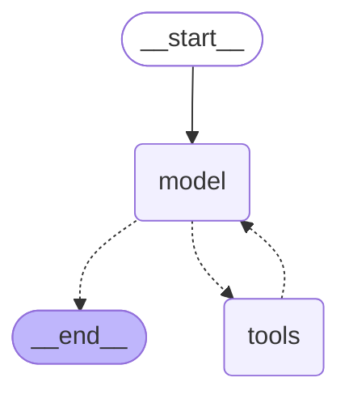

# AI Code Assistant — RAG over arXiv (AI / Software Development)

Learning project to get hands-on with LangChain, RAG, and agents by building an
assistant that answers questions about AI and software development, grounded in
arXiv papers (2020–present).

## Idea

1. Pull paper metadata (and eventually full text) from arXiv for AI / software
   development categories since 2020.
2. Chunk and embed the content, upsert into Pinecone as the knowledge base.
3. Serve an API where a user asks a question; if it's in-scope, we retrieve
   from Pinecone as ground truth and answer with an LLM, citing sources.

Two independent systems, built and tested separately:

- **Offline ingestion pipeline** — fetch → parse → chunk → embed → upsert.
- **Online serving API** — query → retrieve → generate.

## Decisions so far

| Question | Decision |
|---|---|
| Scraping vs. arXiv API | Use the official **arXiv API** — no HTML scraping. Clean metadata (title, abstract, authors, categories) for free; full text still needs PDF parsing. |
| MVP scope | Start with **abstracts only**, narrower category filter (e.g. `cs.SE` + a slice of `cs.AI`/`cs.LG`) rather than the full corpus. Expand to full-text chunking later. |
| Relevance gating | No separate classifier — retrieve, then let the **LLM decide** post-retrieval whether context is sufficient. If not, fall back to a live web search (still scoped to AI/software-dev topics) before giving up and saying so honestly. |
| Pipeline structure | Split ingestion (offline) from serving (online) from day one. |
| Chunking strategy (MVP) | One chunk per paper = its abstract, behind a `ChunkerStrategy` interface. Full-text chunking strategy is still open — decide via benchmarks (see below) once full-text parsing exists. |
| Embedding model | **OpenAI `text-embedding-3-small`** (1536-dim) — cheap (~$0.12 for the full corpus), fast, best LangChain support. Alternatives to benchmark later in [TODO.md](TODO.md). |
| Agent LLM | **OpenAI `gpt-5-mini`** — single-provider stack (same account as embeddings); confirmed working with tool-calling. See [docs/agent-plan.md](docs/agent-plan.md). |
| Web search fallback | **Tavily**, via `langchain-tavily`, as a second agent tool used only when the corpus has nothing relevant. |

## Open decisions

- **Full-text chunking strategy** — to be settled empirically (see Benchmarking below) once full-text parsing exists.
- **Exact OpenAI model size** (`gpt-5` vs. `gpt-5-mini` vs. `gpt-5-nano`) — see [docs/agent-plan.md](docs/agent-plan.md).

## Ingestion pipeline (offline)

**Status: implemented** (`ingestion/`) — this is the design; for exact
commands see [How to run it, step by step](#how-to-run-it-step-by-step)
below, or [docs/data-ingestion-plan.md](docs/data-ingestion-plan.md) for
the full detailed design.

1. **Fetch metadata** — query the arXiv API for `cs.SE` + `cs.PL` in full,
   plus `cs.AI`/`cs.LG`/`cs.CL` filtered to abstracts mentioning a
   software-dev term (too large/generic to take in full — see
   `ingestion/config.py`), filtered to submission date ≥ 2020-01-01. Store
   raw metadata (id, title, abstract, authors, categories, published date,
   PDF URL). Currently ~30k papers.
2. **(Later) Fetch & parse full text** — download PDFs for papers that pass the
   MVP scope, extract text with PyMuPDF or GROBID. Deferred until abstract-only
   pipeline works end-to-end (it now does).
3. **Chunk** — one chunk per paper (its abstract) for the MVP — see
   "Decisions so far" above. Full-text chunking strategy is still open
   (see Benchmarking) once full-text parsing exists.
4. **Embed** — OpenAI `text-embedding-3-small`, batched.
5. **Upsert to Pinecone** — store vectors with metadata needed for citations:
   paper id, title, authors, categories, published date, source URL.
6. **Idempotency** — re-running ingestion should not duplicate vectors; key by
   paper id (+ chunk index) so re-ingestion upserts in place. A content-hash
   cache also skips re-embedding chunks that haven't changed.

## Serving API (online, agentic)

**Status: implemented** (`agent/`, `ui/chat_app.py`) — see
[docs/agent-plan.md](docs/agent-plan.md) for the full design (verified
against real, current LangChain/OpenAI/Tavily APIs before writing it) and
[TODO.md](TODO.md) for what's still open. Verified end-to-end against
real OpenAI/Pinecone/Tavily, including by hand through the actual chat UI
in a browser, not just described below.

### Agent graph

The actual compiled LangGraph structure (`agent.get_graph().draw_mermaid()`
— not hand-drawn, this is what `agent/graph.py`'s `create_agent(...)`
really builds):



`model` is the OpenAI LLM deciding what to do next; `tools` is a single
node bundling both `search_papers` (Pinecone corpus) and `web_search`
(Tavily) — the graph itself just loops model ↔ tools until the model
stops requesting tool calls. Which tool gets called, in what order
(corpus first, web only as a fallback), and when to give up and decline
is **prompt-level behavior** (`SYSTEM_PROMPT` in `agent/graph.py`), not
enforced by the graph's edges.

1. User submits a question via a Streamlit chat UI.
2. A LangChain tool-calling agent (`langchain.agents.create_agent`,
   OpenAI `gpt-5-mini`) decides whether to search the paper corpus.
3. `search_papers` tool: embeds the query, retrieves top-k chunks from
   Pinecone.
   - Relevant results → answer grounded in the retrieved chunks, with
     citations (paper title + link).
   - Nothing relevant → falls back to a `web_search` tool (Tavily),
     still scoped by the system prompt to AI/software-dev topics.
     - Web results found → answer from them, clearly marked as
       web-sourced rather than from the curated corpus.
     - Still nothing relevant → says so honestly rather than
       hallucinating.
4. Return answer + sources (labeled by which tool they came from) to the user.
5. This two-tool decision (corpus vs. web vs. neither) is the first real
   "agentic" behavior; more (e.g. query rewriting, multi-hop retrieval)
   can be layered on once this works.

## Benchmarking chunking strategies

Before committing to one approach, test candidates against a small labeled set
of questions + expected source papers, comparing retrieval precision/recall
and answer quality:

- Abstract-only chunks (one chunk per paper).
- Fixed-size token windows with overlap, over full text.
- Section-aware chunking (intro/method/results/etc.) once full-text parsing
  is in place.

Track: retrieval hit rate, chunk count / index size, embedding cost, and
qualitative answer grounding.

## Tech stack

- **LangChain** — orchestration, retrieval chain, agent logic.
- **arXiv API** — paper metadata source.
- **PyMuPDF / GROBID** — PDF → text parsing (once full-text is in scope).
- **Pinecone** — vector store.
- **LLM** — provider/model TBD.

## How to run it, step by step

Status: fetch, normalize, chunk/embed/upsert are all implemented
(`ingestion/`) and have been run end-to-end against the full ~30k-paper
corpus. See [TODO.md](TODO.md) for deferred enhancements, and
`ingestion/config.py` / `ingestion/embedding_config.py` for every knob
mentioned below.

### 0. Setup

```bash
python3 -m venv .venv
.venv/bin/python -m pip install -r requirements-dev.txt   # includes pytest
```

Fetch/normalize need no API keys (the arXiv API requires no auth). Step 4
(embed) needs `OPENAI_API_KEY`/`PINECONE_API_KEY` — copy `.env.example` to
`.env` and fill in your own keys before that step; `.env` is gitignored.

### 1. (Optional) Run the tests

```bash
.venv/bin/python -m pytest -q
```

Mocked unit tests only — fast, no network. There's also a small
integration suite that hits the real arXiv API, skipped by default:

```bash
RUN_ARXIV_INTEGRATION_TESTS=1 .venv/bin/python -m pytest tests/test_arxiv_integration.py -v
```

### 2. Fetch raw metadata from arXiv

```bash
# Small capped run, good for a first sanity check / debugging:
.venv/bin/python -m ingestion.cli fetch --max-results 15 --db-path data/papers.db

# Full scope (cs.SE + cs.PL, plus keyword-filtered cs.AI/cs.LG/cs.CL, since 2020-01-01):
.venv/bin/python -m ingestion.cli fetch --db-path data/papers.db
```

Useful flags: `--categories`, `--keyword-categories`, `--keywords`,
`--start-date`, `--max-results`. Rate-limited to arXiv's courtesy
~3s/request, so an uncapped full run over ~30k papers takes a while (tens
of minutes) — start with `--max-results` while debugging.

Data lands in the `papers` table of the SQLite file at `--db-path`
(`data/` is gitignored — this is local scratch data, not committed).

### 3. Filter & normalize

```bash
.venv/bin/python -m ingestion.cli normalize --db-path data/papers.db
```

Reads everything in the raw store, drops out-of-scope/withdrawn/malformed
papers, cleans title/abstract text, and writes the result to a separate
`normalized_papers` table in the same file. Re-run anytime after a fetch —
it's idempotent and safe to re-run after tweaking scope/keywords without
re-fetching.

### 4. Chunk, embed, and upsert to Pinecone

```bash
# Smoke-test with a handful of papers before committing to a full run:
.venv/bin/python -m ingestion.cli embed --limit 3

# Full run (~30k papers, a few minutes):
.venv/bin/python -m ingestion.cli embed
```

One chunk per paper (its abstract) for the MVP, embedded with OpenAI
`text-embedding-3-small` (1536-dim) and upserted into a Pinecone index
(created automatically on first run if it doesn't exist, named whatever
`PINECONE_INDEX_NAME` resolves to, default `ai-code-assistant`).
Re-running skips any chunk whose text hasn't changed since the last run —
tracked via a content hash in an `embedded_chunks` table in the same
SQLite file — so it's both idempotent and cheap to re-run.

### 5. Verify it landed in Pinecone

Check https://app.pinecone.io — open your index and its dashboard shows
the vector count and dimension directly (should match the normalized
paper count and 1536); use the console's query/browse tool to inspect
individual vectors and metadata.

### 6. Chat with the agent

Prerequisites: the Pinecone index is populated (steps 2–5) and `.env`
contains `OPENAI_API_KEY`, `PINECONE_API_KEY`, `PINECONE_INDEX_NAME` and
`TAVILY_API_KEY` (copy `.env.example` if you haven't yet).

```bash
.venv/bin/python -m pip install -r requirements.txt   # first time only
.venv/bin/streamlit run ui/chat_app.py
```

Opens a browser tab (http://localhost:8501) with a chat UI. Streamlit
reloads on file changes, so you can edit and test live. On Streamlit Cloud,
put the same keys in the app's secrets instead of `.env`. Ask anything about AI/software-dev
research — the agent searches the corpus first, falls back to a live web
search (still scoped to AI/software-dev topics) if the corpus has nothing
relevant, and declines outright if the question is unrelated to either.
Each answer has a collapsible "Sources" list, labeled by whether it came
from the paper corpus or the web.

#### Run with Docker

Only the chat app is containerized (ingestion stays a local/offline step).
It queries an already-populated Pinecone index.

```bash
cp .env.example .env        # fill in OPENAI_API_KEY, PINECONE_API_KEY,
                            # PINECONE_INDEX_NAME, TAVILY_API_KEY
docker compose up --build   # then open http://localhost:8501
```

The image never contains `.env` (it is in `.dockerignore`); the keys are
injected at run time via `env_file`. Anyone who can run the container can
read those env vars, so use dedicated, spend-capped keys and revoke them
afterwards.

### Debugging tips

- Both CLI commands log counts (`Fetched N papers`, `Normalized N, dropped
  N`) — a big gap between fetched and normalized counts is worth checking
  with `scripts/inspect_db.py`.
- Run `fetch` with a small `--max-results` first; only drop the cap once a
  small batch looks right end-to-end.
- Logging is INFO by default; category/date/withdrawn drops during
  `normalize` log at DEBUG/INFO — see `ingestion/normalize.py` if you need
  to see exactly why a specific paper was dropped.

## Visualizing the dataset locally

There's no `sqlite3` CLI or GUI browser installed in this environment (and
installing one needs `sudo`, which isn't available non-interactively here),
so `scripts/inspect_db.py` is a small stdlib-only tool for looking at the
data without extra setup:

```bash
# Row counts, published-date range, and category breakdown for both tables:
.venv/bin/python scripts/inspect_db.py summary

# Most recent N rows (default: normalized table):
.venv/bin/python scripts/inspect_db.py sample --table normalized --limit 20
.venv/bin/python scripts/inspect_db.py sample --table raw --limit 20

# Full-text-ish search over title/abstract:
.venv/bin/python scripts/inspect_db.py search "program repair" --table normalized
```

Other options if you want something more visual:

- **DB Browser for SQLite** (GUI, spreadsheet-like) — not installed here;
  `flatpak install flathub io.github.sqlitebrowser.sqlitebrowser` or your
  distro's package manager if you want it locally.
- **pandas in a notebook/REPL** for quick stats or plots:
  ```python
  import sqlite3, pandas as pd
  conn = sqlite3.connect("data/papers.db")
  df = pd.read_sql("SELECT * FROM normalized_papers", conn)
  df["primary_category"].value_counts()
  ```
  (`pip install pandas` — not in requirements.txt, since it's only needed
  for ad hoc exploration, not the pipeline itself.)

## Roadmap

1. ~~Ingestion MVP: arXiv API fetch (metadata only, narrow categories) →
   embed abstracts → upsert to Pinecone.~~ Done.
2. ~~Serving MVP: chat agent, corpus search → web search fallback →
   honest "nothing found" as a last resort.~~ Done — see
   [docs/agent-plan.md](docs/agent-plan.md) (`rag-agent` branch).
3. Chunking benchmarks: compare strategies once full-text parsing is added.
4. Expand category/date coverage based on MVP learnings.
5. Layer in agent behavior beyond corpus-vs-web-vs-neither (e.g. query
   rewriting, multi-hop retrieval, durable multi-session memory).
