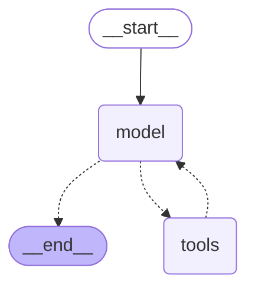

# Agent and chat UI (online)

The serving side of the project: a tool-calling LangGraph agent that answers
AI / software-development questions from the arXiv corpus, falling back to web
search, plus the Streamlit chat app on top of it.

**Status: implemented** and verified end-to-end against real
OpenAI / Pinecone / Tavily, including by hand through the chat UI in a browser.
Full design notes: [../docs/agent-plan.md](../docs/agent-plan.md). Deferred
work: [../TODO.md](../TODO.md).

## Running the chat app

Prerequisites: `uv sync`, a `.env` with `OPENAI_API_KEY`, `PINECONE_API_KEY`
and `TAVILY_API_KEY` (copy `.env.example`), and a populated Pinecone index —
see [../ingestion/README.md](../ingestion/README.md).

```bash
uv run streamlit run ui/chat_app.py
```

Opens a browser tab with a chat UI. Ask anything about AI/software-dev
research — the agent searches the corpus first, falls back to a live web
search (still scoped to AI/software-dev topics) if the corpus has nothing
relevant, and declines outright if the question is unrelated to either. Each
answer has a collapsible "Sources" list, deduplicated by URL and labeled by
whether it came from the paper corpus or the web. The **New Chat** button
starts a fresh conversation thread.

## How the agent works

The actual compiled LangGraph structure (`agent.get_graph().draw_mermaid()` —
not hand-drawn, this is what `create_agent(...)` in `graph.py` really builds):



`model` is the OpenAI LLM deciding what to do next; `tools` is a single node
bundling both tools. The graph just loops model ↔ tools until the model stops
requesting tool calls. Which tool is called, in what order, and when to give
up are **prompt-level behavior** (`SYSTEM_PROMPT` in `graph.py`), not enforced
by the graph's edges.

1. The user submits a question in the Streamlit chat UI.
2. **Step 0, scope check:** if the question isn't about AI or software
   development, the agent declines without calling any tool. (An early prompt
   version let it answer a cookie-recipe question from general knowledge; the
   explicit Step 0 plus a regression test fixed that.)
3. **`search_papers`:** embeds the query and retrieves the top-k chunks from
   Pinecone.
   - Relevant results → answer grounded in the chunks, citing paper title +
     link.
   - Nothing relevant → fall back to `web_search`.
4. **`web_search`** (Tavily): answers from web results, clearly marked as
   web-sourced rather than from the curated corpus. If nothing relevant turns
   up either, the agent says so rather than hallucinating.
5. The answer and its sources (labeled by tool) go back to the user.

Query rewriting and multi-hop retrieval can be layered on later.

## Files

| File | Purpose |
|---|---|
| `config.py` | `AgentConfig` — LLM model/temperature, retrieval `top_k`, web-search result count. Composes `EmbeddingConfig` from `ingestion/` so queries are embedded with the same model/dimension/index as the corpus. |
| `retrieval_tool.py` | The `search_papers` tool (Pinecone query). |
| `graph.py` | `build_agent()`: both tools, the system prompt, and an `InMemorySaver` checkpointer for per-thread conversation memory. |
| `results.py` | `extract_sources()` (deduplicated citations from a turn's tool results) and `classify_answer_source()` (corpus / web / not-grounded badge). Used by the UI; unit-tested. |
| `../ui/chat_app.py` | Streamlit chat interface: session state, rendering, styling. |

Conversation memory is process-local (lost when the Streamlit server
restarts), which is fine for local single-user use.

## Tests

```bash
uv run pytest -q    # fast mocked unit tests (includes the retrieval tool)
```

Opt-in tests against the real APIs are in
[../integration_tests/](../integration_tests/) and are skipped by default
because they cost a little money and need credentials:

```bash
RUN_AGENT_INTEGRATION_TESTS=1 uv run pytest integration_tests/test_agent_integration.py -v
RUN_ARXIV_INTEGRATION_TESTS=1 uv run pytest integration_tests/test_arxiv_integration.py -v
RUN_INGESTION_INTEGRATION_TESTS=1 uv run pytest integration_tests/test_ingestion_pipeline.py -v
```

The agent suite covers the three paths: corpus hit, web fallback, and
out-of-scope decline.
